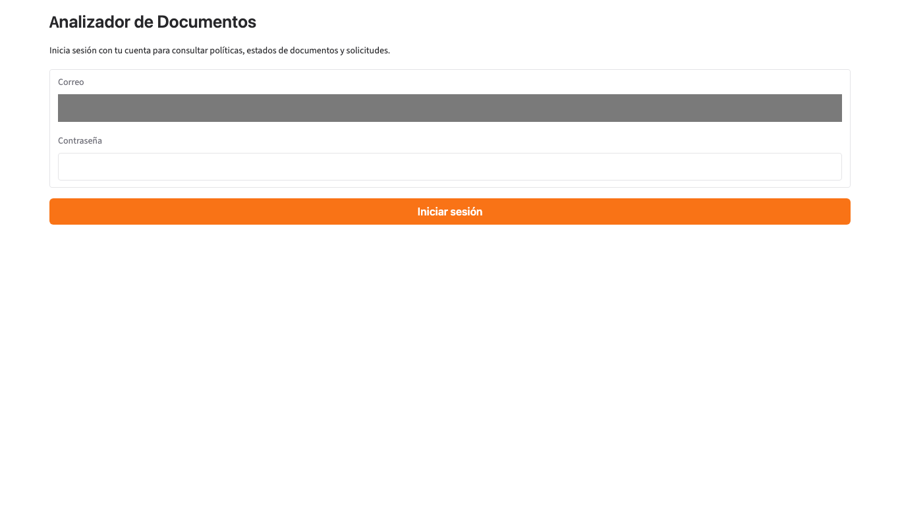
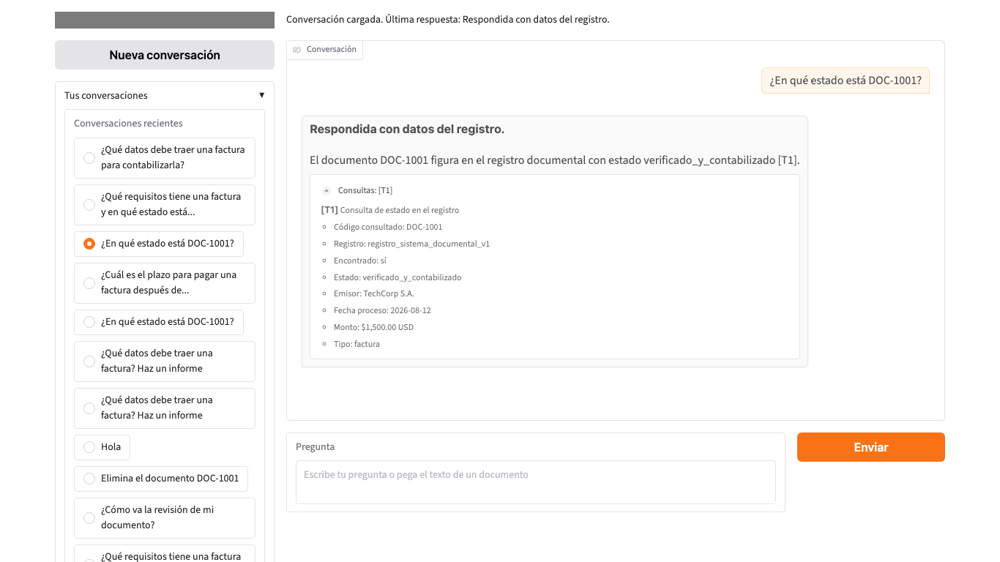
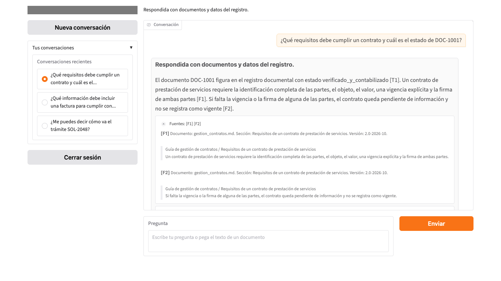
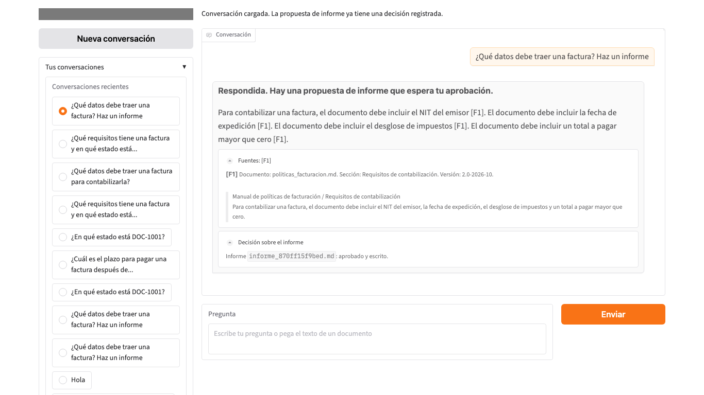
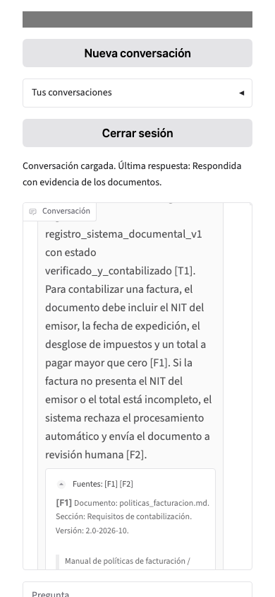

# Analizador de Documentos

Aplicación web para consultar políticas de facturación, contratos y documentos de identificación con fuentes citadas, revisar el estado de documentos y solicitudes y preparar informes que solo se escriben con aprobación del usuario.

Proyecto del curso Inteligencia Artificial Generativa y Sistemas Inteligentes, EAM 2026-II. Equipo: Pablo Garcés Hoyos y Axel Dereck Gutiérrez.

Aplicación publicada: https://analizador-documentos-v871.onrender.com

## Problema

Quien revisa facturas, contratos y documentos de identificación necesita saber qué exige cada política, en qué estado va un trámite y si un documento cumple lo mínimo, sin que un modelo invente requisitos ni estados. La aplicación responde solo con lo que está escrito en el corpus, cita el pasaje de cada frase, consulta el estado en un registro y separa la falta de evidencia de un error técnico.

## Arquitectura resumida

- Interfaz Gradio con inicio de sesión de Supabase Auth.
- Enrutador por reglas, que elige entre consulta de estado, pregunta de políticas, pregunta mixta, clasificación de un documento, rechazo o aclaración.
- Servidor MCP propio, de solo lectura, para el estado de `DOC-XXXX` y `SOL-XXXX`.
- RAG sobre Supabase pgvector, con recuperación híbrida (BM25 y embeddings, fusión RRF y reordenamiento) y modelos ONNX cargados bajo demanda.
- Modelo `openai/gpt-oss-20b` de Groq, con salida JSON validada: cada frase lleva la cita de su pasaje.
- Informe en Markdown escrito con el Filesystem MCP solo después de la aprobación del usuario.
- Conversaciones y mensajes de cada usuario guardados en Supabase con seguridad a nivel de fila.

El detalle está en [`app/README.md`](app/README.md).

## Ejecución rápida

Linux/macOS, con Python 3.13:

```bash
git clone https://github.com/pabloGarcesHoyos/analizador-documentos-ia
cd analizador-documentos-ia
python3.13 -m venv .venv
.venv/bin/python -m pip install -r app/requirements.txt
cp app/.env.ejemplo app/.env
cd app
../.venv/bin/python descargar_modelos.py
../.venv/bin/npm ci --prefix mcp_archivos --omit=dev
../.venv/bin/python app.py
```

Antes de arrancar hay que completar `app/.env` y preparar Supabase (SQL, usuarios y corpus). Los pasos completos, PowerShell incluido, están en [`app/README.md`](app/README.md).

## Capturas

Inicio de sesión con la cuenta de Supabase Auth de cada persona (el correo está cubierto en todas las capturas).



Consulta de estado de `DOC-1001` en la URL pública: la frase la escribe el programa con el dato del registro y su consulta `[T1]`, sin llamar al modelo.



Pregunta mixta en la URL pública: el estado de `DOC-1001` con `[T1]` y los requisitos de un contrato con `[F1]` y `[F2]`, con el documento, la sección y el pasaje de cada fuente.



Propuesta de informe aprobada en la URL pública: al reabrir la conversación se ve el informe aprobado y escrito, sin botones para decidir otra vez.



Vista en un celular de 390 px de ancho: la lista de conversaciones queda plegada y la respuesta muestra sus fuentes.



El recorrido completo, con cada paso, lo esperado y lo observado, está en [`evidencias/fase3/prueba_interfaz.md`](evidencias/fase3/prueba_interfaz.md) y [`evidencias/fase4/pruebas_url_publica.md`](evidencias/fase4/pruebas_url_publica.md).

## Documentación

- [`app/README.md`](app/README.md): instalación, configuración, corpus, Supabase, MCP, despliegue, pruebas y limitaciones.
- [`BITACORA_PROYECTO.md`](BITACORA_PROYECTO.md): bitácora unificada de los tres cortes: decisiones, experimentos, errores, aportes y configuración vigente.
- [`app/presentacion_proyecto.pdf`](app/presentacion_proyecto.pdf): presentación del proyecto (fuente en [`presentacion/`](presentacion/)).
- [`evidencias/`](evidencias/): resultados de las pruebas de cada fase y de los cortes 1 y 2.
- [`notebooks/`](notebooks/): notebooks de los cortes anteriores.

Licencia: MIT ([`LICENSE`](LICENSE)).
